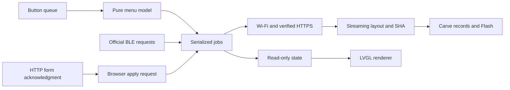

**English** · [简体中文](zion.zh_CN.md)

# Zion product architecture and compatibility

## Publishable artifacts

Production `tools/package_zion.py` runs automatically from `tools/build-zion.ps1`
and exports `release/ZION-<version>-<firmware-sha-prefix>.bin`, `.sha256`, and
`.json`. Every filename carries the version; the digest distinguishes rebuilds.
Only the verified bootable hybrid and public metadata go into this tracked
directory. Matching ELF/MAP/component images remain in ignored `dist/`; test-control
builds never enter `release/`. An existing verified package can be exported with
`python tools/zion_release.py --package dist/<version>/<elf-prefix>`.
The BIN is for initial flashing at `0x0` or a compatible launcher upgrade flow;
raw full-file flashing may reset stored settings.
For a stub error while finalizing a compressed USB write, the same verified
package can be retried with `tools/flash_zion.py --no-compress`; this does not
require clearing games or settings with `--fresh`.

The [ZION source repository](https://github.com/cexer/folo-ai-passport-zion) derives
from `alexwwang/meta-pass` at `3841005015352eeb73026a74dabb9f0c7bcabf4e`
and the public FoloToy 592 v4 protocol. Identity is maintained in
`zion-product.json`; downloaded dependencies and local research artifacts are not source files.

## Runtime ownership

The native UI uses uncompressed 14px/4-bpp glyphs; battery text uses 10px/4-bpp
ASCII. The row number/size/version line retains its original Unscii 8 font.
A complete 6,873-character 14px/1-bpp font
remains the fallback for external names. `main/zion_fonts.h` centralizes widget
selection. The UI subset is derived from launcher/text/install-view literals;
host checks require regeneration after adding characters. Test firmware resolves
every subset glyph and compares the actual LVGL A8 decoder against its raw
4-bpp data, including a character resolved through the full fallback. This change
keeps the existing log levels, drawing configuration and Flash partition table.

Default `sdkconfig.defaults` enables `CONFIG_ZION_LAUNCHER` and the verified
mini-program backend. `main/zion_service.c` owns `app_main`, BLE, Wi-Fi and one
serialized job worker. `main/zion_launcher.c` owns the drawn UI; `zion_menu.c`
is the ESP-IDF/LVGL-independent navigation and confirmation model.
`zion_manage.c` implements image-bound defaults and durable APP/DATA deletion.
`main/main.c` remains a legacy implementation for its explicit test overlay;
it is not the product entry point.

Button callbacks only enqueue. Flash, NVS and networking run in the worker.
Non-LVGL tasks hold `bsp_lvgl_lock()` while accessing objects. The permanent UI
uses stable label buffers to avoid heap churn during TLS. Storage scratch is
leased for a transaction and released before the idle UI and after jobs; the
canonical catalog remains valid. The optional generated QR is freed outside the
idle installation page, including before download progress is displayed.

Wi-Fi has one owner. Temporary open AP + HTTP configuration shares the service
with mini-program BLE provisioning. The form is acknowledged before its page
triggers `/apply`; the HTTP handler does not disconnect its own response path.
Only a successful connection is saved. The AP/server stops before downloads.
AP-only DNS, HTTP probe redirects and DHCP option 114 request captive-portal
opening; HTTPS is not intercepted. The result page polls `/status`, acknowledges
success with `/finish`, and attempts the public entry used by the official
[website module](https://ai-passport.folotoy.cn/_next/static/chunks/mini-program-DP_ytNE7.js).
The open button and local PNG of the existing Mini Program code remain available
when launch is blocked. A pure model bounds the success handoff to 10 seconds
after acknowledgement, or 90 seconds without it; errors never start this timer.
DNS task/socket shutdown precedes AP teardown. Packet parser and lifecycle have
host tests; actual phone popup and WeChat launch remain phone acceptance checks.

## Layout and installation

The product uses `partitions.zion.csv`: 2 MiB factory at `0x10000`, pool0
`0x210000..0x356000`, protected identity `0x356000..0x35a000`, store at
`0x35a000`, pool1 `0x360000..0x7fe000`, and otadata at `0x7fe000`.
Factory size is shared with the bootloader. Old 1.44 MiB layouts require an
explicit fresh installation; this is not a lossless layout migration.
Compatible segmented updates preserve NVS, store and games.

Each install probes only the prefix through the partition table and first valid
APP header, then closes HTTPS before storage allocation/erasure. There is one
complete BIN transfer, not two; read/hash/parse/write work is streamed. This
supports the official route even when it ignores HTTP Range. The first-fit
planner reserves the largest APP capacity that still permits all owned DATA,
uses parsed segment lengths as lower bounds, then shrinks to the actual image
size at commit. Prefix size depends on the source APP offset.
Only the selected APP and supported owned DATA are routed, with immediate
write/readback checks. The ESP image header remains erased until the complete
published SHA-256 matches. A failed transfer leaves an unbootable EMPTY slot.
IDF image verification, installed-image SHA, durable A/B records and the runtime
partition table precede READY. READY counters remain package byte counts.
The child's DATA labels are materialized only for that child before boot.
Official community URLs resolve titles via public metadata matched to the same
file size and SHA. Fallback project names are labeled as projects. The bounded
streaming metadata collector never buffers the entire play response. Download
telemetry records actual bytes, read-block time, Flash time and total time.
Modem sleep is disabled for the transaction and restored afterward. The TCP
window remains 8 KiB; enlarge it only after measuring the TLS/RAM budget.
Test-only `ZION PS ON/OFF` supports a live radio comparison; `ZION HOLD ON/OFF`
suppresses post-install boot for repeated benchmarks. Both are absent in production.

The BLE adapter advertises the legacy 592 virtual wire layout; those advertised
addresses are never write destinations. Actual allocation uses the validated
product geometry. OTA-only merged sources and source addresses other than
`0x10000` are parsed rather than copied blindly.

TLS verification remains enabled. The C3 has no PSRAM. Large-play testing found
receive allocations failing despite sufficient aggregate heap. The profile caps
the TCP receive window at 8 KiB, releases peer certificates only after verified
handshake completion, and uses ESP-IDF's static RX strategy after its dynamic
handshake. Full-size TLS records remain supported. Temporary HTTP EAGAIN is
retried at most three consecutive times; all errors retain their layer.

## Management and recovery

A default binds play identity, offset and image SHA, so inserting another slot
cannot silently change it. Cold startup has a cancellation window. Software
returns and crash/watchdog resets stay in Zion. Optional `zion_hook.h` integration
can skip default once; arbitrary children need not implement a return hook for
the universal hold-Up startup escape.

Deletion defaults to Cancel. It clears a matching default, commits removal of
exactly that APP and its owned DATA, then erases the old extents. Before-commit
failure never erases APP. After-commit erase failure reports pending cleanup
and never rolls metadata back to erased bytes. Incomplete installations remain
manageable but cannot be started/defaulted. Other games and shared NVS remain.

The pool totals about 5.89 MiB; eight metadata slots do not guarantee eight games
fit. APP cards show slot capacity, while owned DATA also counts against free
space. Generic firmware project names are used when a package has no embedded
title. There is no per-child NVS isolation or sandbox around third-party raw
Flash/OTA behavior. Compatibility of each child still needs validation.
The inherited USB web allocator rejects this 2 MiB profile and is not the current
product install path. Official phone entry-button eligibility also needs real
phone acceptance; Windows replay does not establish that frontend behavior.

## Validation and current checkpoint

The installation entry displays the official service-issued WeChat Mini Program
code from `assets/images/folo-mini-code-manifest.json`, not a URL QR for the
community website. WeChat recognition/destination requires a real phone test;
desktop standard-QR decoding cannot establish it. Indexed code images use
LVGL's indexed decoder, which emits ARGB8888 scanlines
even with an RGB565 LCD. Keep `CONFIG_LV_DRAW_SW_SUPPORT_ARGB8888=y`; otherwise
the QR object and encoded source exist but the RGB565 blender skips every pixel.
The host fixture compiles the actual vendor blender with the flag off and on.
Test-control builds also support `ZION QR`, exporting an RGB565 snapshot of only
the public code so host tests can compare rendered pixels to the issued pattern. Snapshot
capture is absent from production; an object-visible flag is not pixel evidence.

Run the full `tools/validate.sh` gate. `tools/build-zion.ps1` and
`tools/package_zion.py` bind component images, merged image, effective config,
ELF/MAP and manifest. `tools/flash_zion.py` is explicit, checks the live factory
geometry, and preserves identity. Build and flash are separate actions.

`CONFIG_META_E2E_TEST_CONTROL` is off by default. The explicit
`sdkconfig.zion-test.defaults` overlay enables synthetic keys through the real
queue/router; production packages assert those commands are absent. Optional
hardware drivers are under `tests/realdevice/zion_*.py`; credentials/identity are
supplied in private external files, never committed.

Accepted scope: full retro Chinese UI, list/default/startup escape, Settings/AP
and BLE setup, official mini-program backend, confirmed deletion, native builds,
and autonomous tests. UI/default/delete and real configuration HTTP checks have
passed on device with test-only keys. The resource-bearing 725 install and boot, complete 2 MiB resource readback,
725/138 coexistence, resource deletion and complete erase-digest checks passed.
USB-reset default startup, OK/Up cancellation and foreground launch while an
unavailable Wi-Fi connection was pending passed; the latter took 1.25 seconds.
The normal package passed a real BLE/HTTPS/Flash reinstall of play 138 and
child boot, then returned to Zion. Its test-key command was verified ineffective.
The device is left online with play 138 retained and default startup disabled. Exact hashes, completed checks and remaining manual acceptance belong
in the final delivery report; do not describe a successful build or replay as
physical-button, pixel, official-phone or child-cloud acceptance.
