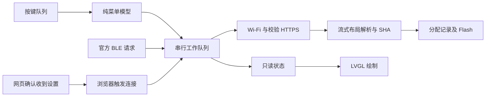

[English](zion.md) · **简体中文**

# Zion 正式项目架构与兼容性

## 可发布产物

`tools/build-zion.ps1` 自动调用 `tools/package_zion.py`，正式包同时导出为
`release/ZION-<版本号>-<固件哈希前缀>.bin`、`.sha256` 和 `.json`。
每个文件名都有版本号，哈希用于区分同版本的不同构建。此受版本控制的目录只保存已验证的
可启动合并包和公开元数据；匹配的 ELF、MAP 和组件镜像仍留在忽略的 `dist/`，测试控制版
不会进入 `release/`。也可导出现有已验证包：
`python tools/zion_release.py --package dist/<版本号>/<ELF哈希前缀>`。
BIN 用于从 `0x0` 首次刷写或兼容的启动器升级流程；直接全文件刷写可能重置已有配置。
USB 压缩写入在收尾阶段被 stub 拒绝时，可对同一已校验包使用
`tools/flash_zion.py --no-compress` 重试，不需要通过 `--fresh` 清空玩法或设置。

[ZION 开源仓库](https://github.com/cexer/folo-ai-passport-zion)派生自
`alexwwang/meta-pass` 的 `3841005015352eeb73026a74dabb9f0c7bcabf4e`，
并兼容公开的 FoloToy 592 v4 协议。包身份由 `zion-product.json` 维护；
下载依赖及本地研究产物不属于源码。

## 运行时职责

原生界面使用未压缩的 14px／4bpp 字库，电量小字使用 10px／4bpp ASCII 字库，
列表编号、大小、版本行保留原来的 Unscii 8 字体及字号；外部玩法名称保留完整
6,873 字符的 14px／1bpp 字库兜底。
`main/zion_fonts.h` 统一控件字体选择。界面子集来自启动器、中文提示及安装信息源码，
增加字符后主机检查会要求重新生成。测试固件逐字解析界面子集，将真实 LVGL 解码的
A8 像素与原始 4bpp 数据比较，并验证通过完整字库回退的字符。本次保持原有日志级别、
绘图配置和 Flash 分区表。

默认 `sdkconfig.defaults` 启用 `CONFIG_ZION_LAUNCHER` 和真实小程序安装后端。
`main/zion_service.c` 承担 `app_main`、BLE、Wi-Fi 及串行工作队列。
`main/zion_launcher.c` 绘制完整界面，`zion_menu.c` 是不依赖 ESP-IDF/LVGL 的
导航与确认模型，`zion_manage.c` 负责镜像身份绑定的默认设置和持久化删除。
`main/main.c` 仅保留为显式旧版测试配置，不再是产品入口。

按键回调只入队，Flash、NVS、网络慢操作在工作任务中执行。LVGL 任务外访问
对象必须加锁。界面使用稳定文字缓冲，避免 TLS 传输中反复分配文字形成碎片。
存储临时缓冲只在事务中申请，空闲界面和每次作业后释放，规范目录状态继续有效。
二维码按需生成，离开空闲安装页或进入下载进度时释放。

Wi-Fi 只有一个管理者。临时开放热点和配置 HTTP 服务与小程序 BLE 配网共用
同一服务。网页先确认收到表单，再由确认页触发 `/apply`，不会在发响应时直接
切断自己的网络路径。成功联网后才保存，开始下载前关闭热点及 HTTP 服务。
仅绑定 AP 的 DNS、HTTP 探测重定向及 DHCP option 114 引导手机弹出配网页，不拦截 HTTPS。
结果页轮询 `/status`，通过 `/finish` 确认成功后，尝试使用
[官网模块](https://ai-passport.folotoy.cn/_next/static/chunks/mini-program-DP_ytNE7.js)的公开入口唤起小程序。
自动唤起被拦截时保留打开按钮，以及现有小程序码的本地 PNG。
纯逻辑模型限制成功后热点保留时间：确认结果后约 10 秒，未确认约 90 秒；失败不启动此定时器。
关闭 AP 前先停止 DNS 任务和套接字。报文解析和生命周期有主机测试；手机实际弹页和唤起微信仍需手机验收。

## 布局和安装

产品采用 `partitions.zion.csv`：factory 为 `0x10000` 起的 2 MiB，pool0 为
`0x210000..0x356000`，身份分区为 `0x356000..0x35a000`，store 位于
`0x35a000`，pool1 为 `0x360000..0x7fe000`，otadata 位于 `0x7fe000`。
应用和 bootloader 共享 factory 大小。旧 1.44 MiB 布局需要显式全新安装，
不支持无损布局迁移；相同布局的分段升级保留 NVS、记录和玩法。

安装先只探测分区表和首个有效 APP 头所在的文件前缀，关闭 HTTPS 后再分配和擦除。
完整 BIN 只传一次，边读、计算哈希、解析和写入；官方下载接口忽略 HTTP Range 时也可使用。
分配器预留仍能放下全部关联 DATA 的最大 APP 容量，以已解析段长度为下界，提交时缩到实际大小。
前缀探测量取决于源 APP 偏移。只写选中的 APP 和支持的关联 DATA，并立即读回验证。
整包公开 SHA-256 一致前，ESP 应用头保持擦除，失败留下不可启动的 EMPTY 槽。
只有 IDF 镜像校验、已安装镜像 SHA、持久化
A/B 记录及运行分区表完成后才发 READY，计数始终是安装包字节数。启动子应用前
仅暴露属于该应用的 DATA 标签。
官方社区下载链接会查询同大小、同 SHA 的公开元数据以获取标题；回退工程名时明确标注为工程。
有界流式元数据提取器不会缓存整个玩法响应。下载日志记录实际字节、读取等待、Flash 写入和总时间。
安装期间关闭 modem sleep，结束后恢复原策略。TCP 窗口仍为 8 KiB，增大前必须测量 TLS/RAM 预算。
仅测试版提供 `ZION PS ON/OFF` 做实时射频对照，`ZION HOLD ON/OFF` 暂停安装后自动启动以便重复测试；
正式版不含这两个控制入口。

BLE 信息帧保留旧 592 的虚拟布局供协议兼容，不能用作实际写入目标。真实分配
使用产品几何。OTA-only 合并包及非 `0x10000` 源地址通过解析识别，不能盲目复制。

保留 TLS 证书验证。无 PSRAM 的 C3 在大包测试中出现总空闲足够但接收分配失败。
当前配置将 TCP 接收窗口限制到 8 KiB，在验证握手完成后释放对端证书，并使用
ESP-IDF 动态握手后的固定接收缓冲策略；仍支持完整 TLS 记录长度。
临时 HTTP EAGAIN 最多连续重试三次，失败保留阶段信息。

## 管理与恢复

默认玩法绑定身份、偏移及镜像 SHA，不因插入槽位而误指另一款。冷启动有取消
窗口，软件返回、崩溃和看门狗恢复时留在 Zion。可选 `zion_hook.h` 可跳过一次
默认；通用“按住上键开机”不要求第三方固件集成返回 hook。

删除确认默认选择返回。先清除匹配默认，再持久化移除指定 APP 和关联 DATA，
随后擦除旧区域。提交前失败不擦除 APP；提交后擦除失败明确标记清理未完成，
不回滚到已擦内容。未完成安装可管理删除，不能启动或设默认。保留其它玩法和
共享 NVS。

池总量约 5.89 MiB，八个元数据槽不代表能装八款。卡片容量是 APP 槽，关联 DATA
另计入空闲统计。没有内嵌标题时显示固件工程名。没有子应用 NVS 隔离，也没有
阻止第三方原始 Flash/OTA 写入的沙箱，需逐款验证兼容性。旧 USB 网页分配器会
拒绝 2 MiB 产品布局，不能作为当前安装通道。官网手机按钮入口的可用性也需要
真实手机验收，Windows 协议重放不能证明这一前端行为。

## 验证与当前检查点

安装入口显示官网签发的微信小程序码，来源见 `assets/images/folo-mini-code-manifest.json`，
不是包含社区网址的普通二维码。微信识别和落地页必须真手机验证，桌面普通二维码解码器
无法证明这项行为。码图经过 LVGL 索引图解码器后，即使 LCD 使用 RGB565，仍输出 ARGB8888 行缓冲。
必须保留 `CONFIG_LV_DRAW_SW_SUPPORT_ARGB8888=y`；否则二维码对象和编码数据存在，
RGB565 混合器却跳过所有像素。主机测试编译真实的依赖库混合器，对比关闭与开启该配置。
测试控制版本还支持 `ZION QR`，仅导出公开码图的 RGB565 绘制快照，供主机逐像素比对
官方图案。正式版不包含快照导出；“对象可见”不等于像素已正确绘制。

运行完整 `tools/validate.sh`。`tools/build-zion.ps1` 和 `tools/package_zion.py`
绑定组件、合并镜像、实际配置、ELF/MAP 和清单。`tools/flash_zion.py` 显式检查
当前 factory 几何并保护身份分区，构建和刷写是两个独立动作。

默认关闭 `CONFIG_META_E2E_TEST_CONTROL`。显式的 `sdkconfig.zion-test.defaults`
配置才允许经真实队列和路由注入按键；正式打包会断言注入命令未链接。
真机脚本位于 `tests/realdevice/zion_*.py`，凭据和身份由外部私有文件提供。

本次范围：完整复古中文 UI、列表与默认启动及取消、设置和 AP/BLE 配网、官方
小程序安装后端、确认删除、原生构建和自主测试。UI、默认、删除及真实配置 HTTP
检查已通过真机测试注入。带资源 725 安装启动、完整 2 MiB 资源读回、725/138 共存、资源删除及
完整擦除哈希检查均已通过。USB 复位默认启动、OK/上键取消，以及不可用 Wi-Fi
等待时启动玩法已通过，后者实测 1.25 秒。正式包已通过 138 的真实 BLE/HTTPS/Flash
重装及子应用启动，并返回 Zion；测试按键命令实测无效。设备留在联网的 Zion，
保留 138，默认启动已关闭。最终精确哈希、已完成项和剩余人工验收写入交付报告，不能把构建或重放
标为实体按键、像素、官方手机或子应用云端验收。
